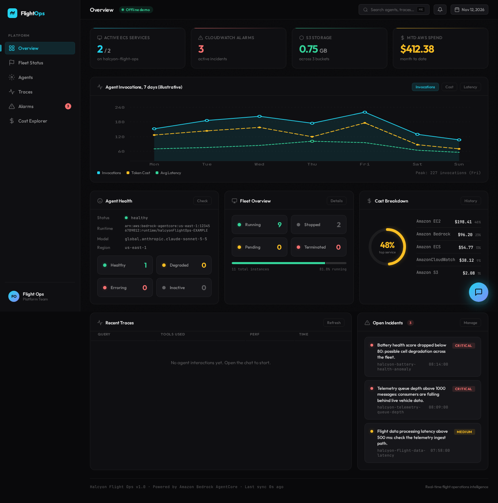
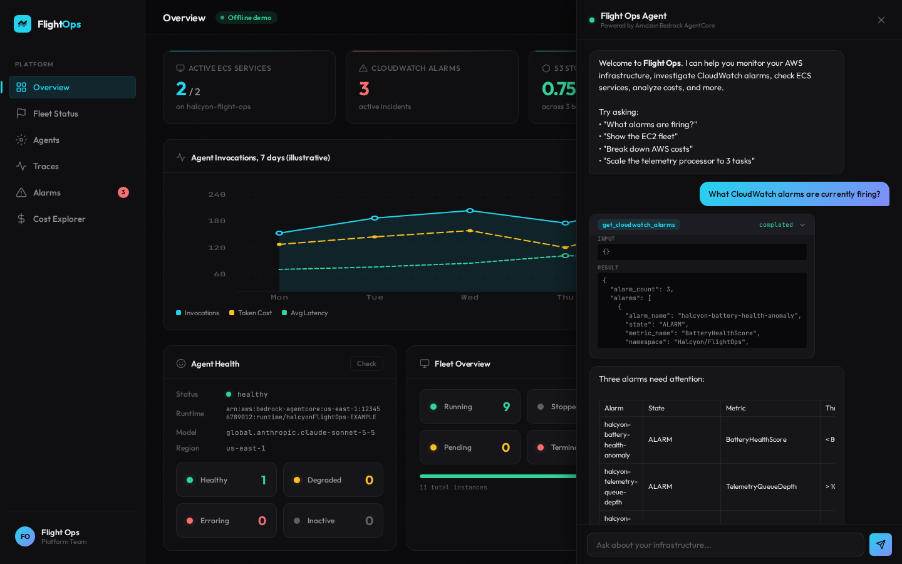
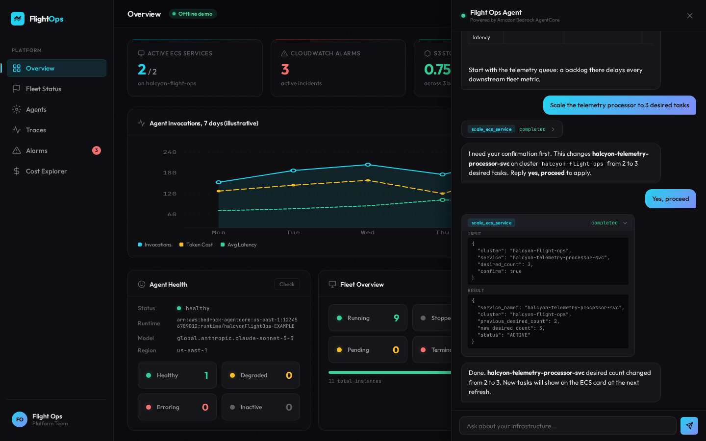
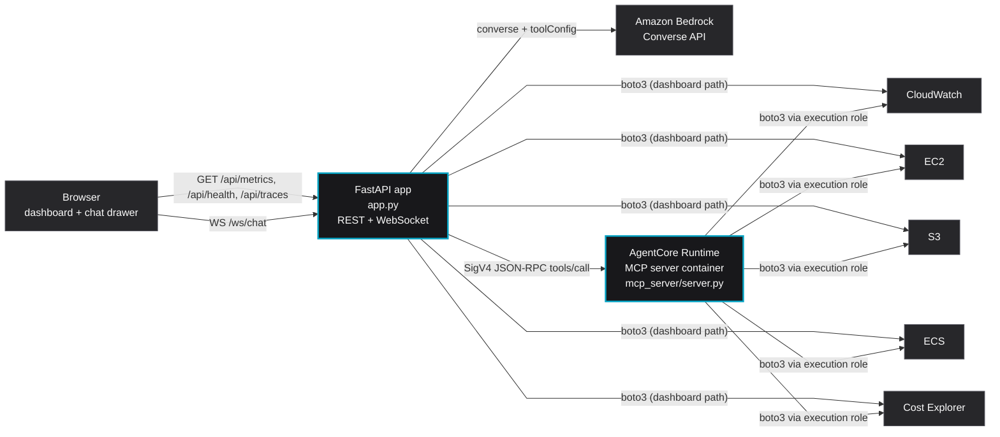

<div align="center">

# Halcyon Flight Ops

**An SRE agent for an eVTOL operator: a FastAPI dashboard plus MCP tools hosted on Amazon Bedrock AgentCore Runtime.**


[Overview](#overview) · [Architecture](#architecture) · [Quickstart](#quickstart-offline) · [Deploy](#deploy-to-aws) · [Cleanup](#cleanup) · [Docs](docs/architecture.md)



<sub>The dashboard in offline demo mode: ECS, alarms, S3 and spend cards, fleet and cost breakdown, and open incidents. All data is synthetic.</sub>

</div>

## Overview

Halcyon Aero (fictional) flies electric air taxis. Its platform team watches telemetry pipelines, simulation compute,
battery analytics and maintenance logs across CloudWatch, ECS, EC2, S3 and Cost Explorer, each in its own console tab.

This repo puts one operator view and one conversational agent on top of those APIs:

| Problem | Example | How this handles it |
|---|---|---|
| Signals live in five consoles | An alarm fires; you open CloudWatch, then ECS, then EC2 | A dashboard reads all five directly with boto3 every 30 s |
| Ad-hoc questions need API knowledge | "Which service costs the most this month?" | A Bedrock Converse agent picks the right tool and answers in a table |
| Tools are tied to one app | The same boto3 helpers get copied into every script | Tools live in one MCP server on AgentCore Runtime, callable by any MCP client |
| Agents that change things are risky | "Scale the telemetry processor" | `scale_ecs_service` returns a preview unless called with `confirm=true`, and the prompt requires user approval first |

### What it demonstrates

- An MCP server (Python, `FastMCP`, stateless Streamable HTTP) packaged as a container and hosted on **AgentCore Runtime**.
- A FastAPI backend calling that runtime with **SigV4-signed JSON-RPC** (`initialize`, `tools/call`).
- A **Bedrock Converse** tool-use loop streamed to the browser over a WebSocket, with token usage logged per call.
- Two data paths: fixed dashboard queries go straight to boto3 (fast, no tokens); open questions go through the agent.
- An **offline mode** (`DEMO_MODE=offline`, the default) that serves synthetic fixtures so everything runs with no AWS account.

<table>
<tr>
<td></td>
<td></td>
</tr>
<tr>
<td align="center"><sub>Alarm investigation: one tool call, answer as a table</sub></td>
<td align="center"><sub>Scaling: preview first, applied only after "yes, proceed"</sub></td>
</tr>
</table>

## Architecture



The agent loop runs in the FastAPI process: Bedrock decides which tool to call, the app forwards the call to the
MCP server on AgentCore Runtime, and the result goes back to Bedrock until it ends the turn (capped at 10 rounds).
Details, sequence diagram and design decisions: [docs/architecture.md](docs/architecture.md).

### MCP tools

| Tool | AWS APIs | Writes? | Notes |
|---|---|---|---|
| `get_cloudwatch_alarms` | `cloudwatch:DescribeAlarms` | No | ALARM and INSUFFICIENT_DATA states |
| `get_ecs_services` | `ecs:ListServices`, `ecs:DescribeServices` | No | Defaults to `ECS_CLUSTER` |
| `get_ec2_fleet` | `ec2:DescribeInstances` | No | Paginated, filter by state, sorted by Name tag |
| `get_s3_storage` | `s3:ListBuckets`, `cloudwatch:GetMetricStatistics` | No | Size from daily `BucketSizeBytes` |
| `get_cost_breakdown` | `ce:GetCostAndUsage` | No | Grouped by service, last N days |
| `scale_ecs_service` | `ecs:DescribeServices`, `ecs:UpdateService` | **Yes** | Preview unless `confirm=true`; rejects negative counts |

## Prerequisites

Offline mode only needs [uv](https://docs.astral.sh/uv/) (Python 3.12+ is installed by uv if missing).

Live mode also needs:

- An AWS **sandbox** account with Amazon Bedrock model access for the inference profile in `BEDROCK_MODEL_ID`
  and AgentCore Runtime available in your Region.
- AWS CLI v2 recent enough to include `bedrock-agentcore-control`, and credentials in your normal credential chain.
- Docker or Finch able to build `linux/arm64` images (`CONTAINER_CLI=finch` to use Finch).

## Quickstart (offline)

```bash
make install      # uv sync
make test         # pytest, no network
make run-local    # http://127.0.0.1:8080 with DEMO_MODE=offline
```

Open the chat (bottom right) and try the prompts in the [demo](#demo) table. No AWS calls are made in this mode.

## Deploy to AWS

Everything below creates billable resources in the account your credentials point at. Use a sandbox account.

```bash
cp .env.example .env              # then edit values
set -a; . ./.env; set +a
export ACCOUNT_ID="$(aws sts get-caller-identity --query Account --output text)"

# 1. Execution role for the runtime (least-privilege templates in iam/; envsubst is from gettext)
aws iam create-role --role-name halcyon-flight-ops-agentcore-runtime \
  --assume-role-policy-document "$(envsubst < iam/trust-policy.json)" \
  --tags Key=Project,Value=halcyon-flight-ops Key=Owner,Value=portfolio Key=Environment,Value=demo
aws iam put-role-policy --role-name halcyon-flight-ops-agentcore-runtime \
  --policy-name halcyon-flight-ops-tools \
  --policy-document "$(envsubst < iam/runtime-role-policy.json)"
export AGENTCORE_ROLE_ARN="arn:aws:iam::${ACCOUNT_ID}:role/halcyon-flight-ops-agentcore-runtime"

# 2. Optional: synthetic demo resources (tags EC2, 3 alarms, 3 S3 buckets, ECS cluster + Fargate service)
make infra

# 3. Build + push the MCP image (linux/arm64) and create the AgentCore Runtime
make deploy                       # prints AGENT_RUNTIME_ARN; put it in .env

# 4. Run the app against live AWS (still bound to 127.0.0.1)
make run-live
```

`make infra` expects an ECS task execution role named `ecsTaskExecutionRole` (override with
`ECS_TASK_EXECUTION_ROLE_ARN`). Its Fargate tasks get public IPs to pull the public `nginx:alpine` image but use the
VPC default security group, which allows no inbound traffic from outside the group.

### Cost (rough, us-east-1, demo usage)

| Service | Assumption | Approx. monthly |
|---|---|---|
| AgentCore Runtime | ~500 tool calls, ~2 s active CPU each; billed on active CPU and memory, idle I/O wait not billed for CPU | < $1 |
| Amazon Bedrock | ~500 chat turns, ~6k input + ~600 output tokens each; price depends on the model you pick | ~$10 to $20 |
| ECS on Fargate (`make infra`) | 2 tasks, 0.25 vCPU / 0.5 GB, running 24x7, plus 2 public IPv4 addresses | ~$25 |
| CloudWatch | 3 standard alarms, logs, `GetMetricStatistics` (S3 sizes cached 1 h) | ~$1 |
| Cost Explorer API | $0.01 per request; dashboard caches spend for 1 h | ~$7 if the dashboard runs 24x7, cents otherwise |
| ECR + S3 | one ~200 MB image, a few KB of sample objects | < $0.10 |

These are estimates, not quotes. Check the current pricing pages for your Region and model. The Fargate service is the
only always-on cost: run `make destroy` when you are done.

## Demo

| Ask | Tool(s) | What to point out |
|---|---|---|
| "What CloudWatch alarms are currently firing?" | `get_cloudwatch_alarms` | Raw alarm JSON becomes a ranked table |
| "Show me the EC2 fleet" | `get_ec2_fleet` | Same data as the dashboard card, now queryable |
| "Break down our AWS spending by service" | `get_cost_breakdown` | One sentence instead of a Cost Explorer report |
| "How much S3 storage are we using?" | `get_s3_storage` | Combines S3 and CloudWatch APIs |
| "Give me a health summary" | several | The model composes tools on its own (live mode) |
| "Scale the telemetry processor to 3 tasks", then "yes, proceed" | `scale_ecs_service` | Preview first, change only after approval |

In offline mode these prompts are matched by keyword to canned answers in `fixtures/offline.json`. The full talk track
is in [docs/demo-script.md](docs/demo-script.md).

## Cleanup

`make destroy` runs [`scripts/destroy.sh`](scripts/destroy.sh), which lists what it will delete and asks for `yes`:

```bash
set -a; . ./.env; set +a      # AWS_REGION, AGENT_RUNTIME_ARN, ECR_REPO, ECS_CLUSTER
make destroy                  # or: CONFIRM=yes ./scripts/destroy.sh
```

It removes, in order:

1. The AgentCore Runtime (`delete-agent-runtime --agent-runtime-id ${AGENT_RUNTIME_ARN##*/}`).
2. The ECR repository `${ECR_REPO}` and all its images (`delete-repository --force`).
3. The ECS service `halcyon-telemetry-processor-svc`, its task definitions, the `${ECS_CLUSTER}` cluster
   (`DELETE_CLUSTER=no` keeps it) and its log group.
4. The three `halcyon-*` CloudWatch alarms.
5. The three `halcyon-*-${ACCOUNT_ID}` S3 buckets and their objects.

Then remove the IAM role you created:

```bash
aws iam delete-role-policy --role-name halcyon-flight-ops-agentcore-runtime --policy-name halcyon-flight-ops-tools
aws iam delete-role --role-name halcyon-flight-ops-agentcore-runtime
```

EC2 instances are never created or deleted by this repo; `make infra` only adds `Name`/`Project`/`Owner`/`Environment`
tags to running instances. The destroy script prints the `aws ec2 delete-tags` command if you want them gone.

## Project layout

```
.
├── app.py                    # FastAPI app: dashboard API, WebSocket agent loop, SigV4 MCP client
├── offline.py                # DEMO_MODE=offline: serves fixtures instead of AWS
├── fixtures/offline.json     # synthetic Halcyon Aero metrics, alarms and canned chat replies
├── prompts/system.md         # agent system prompt
├── static/index.html         # single-file dashboard + chat drawer (no build step)
├── mcp_server/
│   ├── server.py             # MCP tools (boto3), Streamable HTTP on 0.0.0.0:8000/mcp
│   ├── Dockerfile            # linux/arm64 image for AgentCore Runtime, non-root user
│   └── requirements.txt
├── iam/                      # trust + least-privilege policy templates for the runtime role
├── scripts/
│   ├── setup_demo_infra.sh   # synthetic demo resources (sandbox only)
│   ├── deploy_mcp.sh         # build, push, create AgentCore Runtime
│   ├── destroy.sh            # tear everything down
│   └── capture_screenshots.py# Playwright screenshots of the offline UI
├── tests/                    # pytest: request parsing, offline mode, scale confirmation guard
├── docs/
│   ├── architecture.md
│   ├── demo-script.md
│   └── assets/               # screenshots used in this README
├── Makefile  pyproject.toml  .env.example  LICENSE
```

## Development

```bash
make test       # 17 tests, offline
make lint       # ruff check + ruff format --check
make capture    # regenerate docs/assets/*.png (headless Chromium via Playwright)
```

## Limitations

- **No authentication on the web app.** It binds to `127.0.0.1` by default and is meant for a single operator on
  their own machine. Putting it on a network needs real auth in front (for example an ALB with Amazon Cognito) first.
- **Conversation memory is in-process.** Each WebSocket keeps its own message list; nothing persists across restarts.
  AgentCore Memory is not used.
- **Traces are local.** The "Recent Traces" table is an in-memory list of the last 100 turns, not AgentCore
  Observability data. The 7-day invocations chart is a static illustration.
- **The confirmation guard is cooperative.** `scale_ecs_service` will not mutate without `confirm=true`, but a model
  could pass `confirm=true` without asking. IAM limits the blast radius to services in `${ECS_CLUSTER}`.
- **Read-only tools use `Resource: "*"`** where the AWS API has no resource-level permissions (DescribeAlarms,
  DescribeInstances, ListAllMyBuckets, GetCostAndUsage). Those statements are labelled in `iam/`.
- **Offline replies are keyword-matched**, not generated. They show the UI and the event flow, not model quality.
- The live AgentCore path follows the AgentCore MCP contract in the AWS docs (port 8000, `/mcp`,
  stateless Streamable HTTP, arm64 image), but there is no automated integration test against a real runtime.

<div align="center"><sub>Halcyon Aero is fictional; all data is synthetic.</sub></div>
