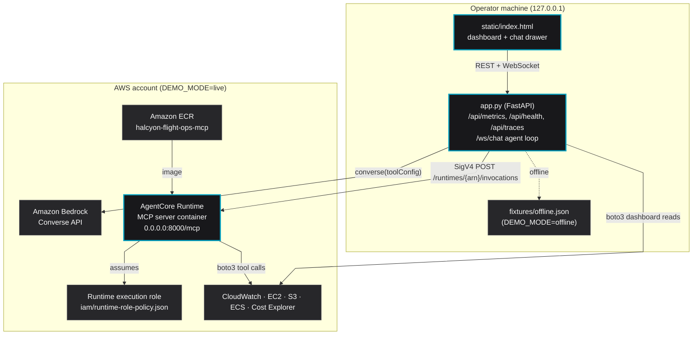
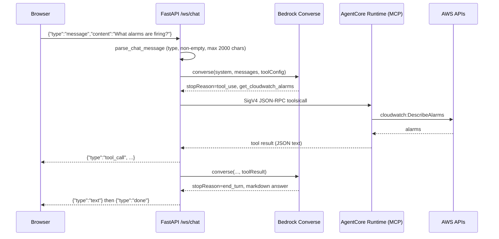

# Halcyon Flight Ops: architecture

## Business context

Halcyon Aero is a fictional operator of electric vertical takeoff and landing (eVTOL) air taxis. Its flight
operations depend on AWS: telemetry ingestion, simulation compute, battery analytics services and maintenance log
storage. The platform team watches these through separate CloudWatch, ECS, EC2, S3 and Cost Explorer consoles.

This demo puts one operator dashboard and one conversational SRE agent on top of the same APIs. The point is to show
how Amazon Bedrock AgentCore Runtime can host existing boto3 logic as MCP tools, without rebuilding the systems
behind them.

## Components

## Data paths

There are two paths, on purpose.

### Path 1: dashboard metrics (direct boto3)

The dashboard polls `GET /api/metrics` every 30 seconds. The backend calls the AWS APIs directly; no model is
involved. Each section (ECS, alarms, EC2, S3, spend) is fetched independently, so one failure shows as an error on that
section and does not blank the page. S3 sizes and Cost Explorer spend are cached for an hour: S3 size metrics are daily,
and Cost Explorer bills $0.01 per request, which would add up at a 30 second refresh.

### Path 2: agent chat (Bedrock + AgentCore)

The loop is capped at 10 model rounds per user message. Token usage is logged on every Converse call and summed into
the per-turn trace shown in the "Recent Traces" table.

In offline mode the same WebSocket protocol is used, but `offline.reply()` matches keywords in the question to canned
`tool_call` and `text` events from `fixtures/offline.json`.

## Authentication and exposure

| Hop | Mechanism |
|---|---|
| Browser to FastAPI | None. The app binds to `127.0.0.1` by default (`HOST` env). Do not expose it without adding auth in front. |
| FastAPI to Bedrock | SigV4 via the standard AWS credential chain |
| FastAPI to AgentCore Runtime | SigV4 (`bedrock-agentcore` service) on the runtime invocation URL |
| Runtime to AWS APIs | The runtime execution role (`iam/runtime-role-policy.json`) |

The MCP container listens on `0.0.0.0:8000` because that is the AgentCore Runtime container contract. No host port is
published; callers reach it only through the SigV4-authenticated AgentCore endpoint.

### Execution role scope

- ECR pull limited to the one repository; logs limited to `/aws/bedrock-agentcore/runtimes/*`.
- `ecs:DescribeServices` and `ecs:UpdateService` limited to services in the demo cluster; `ecs:ListServices`
  conditioned on that cluster.
- `cloudwatch:DescribeAlarms`, `cloudwatch:GetMetricStatistics`, `ec2:DescribeInstances`, `s3:ListAllMyBuckets` and
  `ce:GetCostAndUsage` use `Resource: "*"` because those actions have no resource-level permissions.

## MCP tools

| Tool | AWS API | Returns |
|---|---|---|
| `get_cloudwatch_alarms` | `DescribeAlarms` (ALARM, INSUFFICIENT_DATA) | name, state, metric, namespace, threshold, operator, last update |
| `get_ecs_services` | `ListServices` + `DescribeServices` | name, status, desired/running/pending, task definition, launch type |
| `get_ec2_fleet` | `DescribeInstances` (paginated) | id, type, state, Name tag, launch time, IPs, AZ |
| `get_s3_storage` | `ListBuckets` + `GetMetricStatistics` | bucket, size bytes/GB, creation date |
| `get_cost_breakdown` | `GetCostAndUsage` grouped by SERVICE | total, currency, period, per-service cost |
| `scale_ecs_service` | `DescribeServices` + `UpdateService` | preview (default) or previous/new desired count |

### The scaling guard

`scale_ecs_service` is the only write. It is two-phase in the tool itself:

1. Called with `confirm=false` (the default) it reads the current desired count and returns a preview. Nothing changes.
2. Called with `confirm=true` it calls `UpdateService` and returns the before and after counts, with a warning when
   scaling to zero or more than tripling.

The system prompt (`prompts/system.md`) tells the model to show the preview and wait for an explicit yes. That part is
cooperative: IAM is what bounds the damage if a model skips it.

## Design decisions

1. **Two data paths.** Dashboard queries are fixed and known, so they skip the model: faster (hundreds of ms instead of
   seconds) and no token cost on every refresh.
2. **Agent loop in the web app, tools on AgentCore.** The app owns the conversation and the Bedrock call; the runtime
   only hosts tools. Any other MCP client (an IDE, another agent) can call the same runtime.
3. **Stateless Streamable HTTP MCP.** AgentCore Runtime expects `0.0.0.0:8000/mcp`; stateless mode is the documented
   choice for basic tool servers.
4. **WebSocket for chat.** A turn can include several tool calls over 5 to 15 seconds; tool cards stream as they happen.
5. **Single-file frontend.** One HTML file with inline CSS and JS, no build step. Model output is HTML-escaped before the
   small markdown renderer adds its own tags.
6. **Cross-region inference profile.** `BEDROCK_MODEL_ID` defaults to a `global.` inference profile for availability;
   change it in `.env`.
7. **Offline mode by default.** A clone runs end to end with no AWS account, and tests never touch the network.

## What is not used

The original sketch of this demo listed AgentCore Memory, Gateway and Observability. None are wired in. Conversation
history is an in-memory list per WebSocket, traces are an in-memory list in the app, and the runtime is called directly
rather than through a Gateway. Adding them is the natural next step.

## References

- [Deploy MCP servers in AgentCore Runtime](https://docs.aws.amazon.com/bedrock-agentcore/latest/devguide/runtime-mcp.html)
- [AgentCore pricing](https://aws.amazon.com/bedrock/agentcore/pricing/)
- [Bedrock Converse API](https://docs.aws.amazon.com/bedrock/latest/userguide/conversation-inference-call.html)
- [create-agent-runtime CLI reference](https://docs.aws.amazon.com/cli/latest/reference/bedrock-agentcore-control/create-agent-runtime.html)
