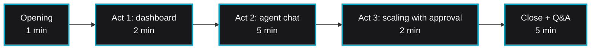

# Halcyon Flight Ops: demo talk track

About 15 minutes including questions. Works in offline mode (canned answers) or live mode (real AWS).



## Pre-demo checklist

- [ ] **App running:** `make run-local` (offline) or `make run-live`, dashboard loads at `http://127.0.0.1:8080`.
- [ ] **Mode badge** in the header says what you expect ("Offline demo" or "Live").
- [ ] **Live only:** `aws sts get-caller-identity` returns the sandbox account; `make infra` has been run so there are
      `halcyon-*` alarms, buckets and an ECS service.
- [ ] **Agent responds:** open the chat and ask "What alarms are firing?".
- [ ] **Screen:** close other tabs, zoom to 125% for a projector.

## Opening (1 minute)

> "This is an operations dashboard for Halcyon Aero, a fictional eVTOL air-taxi operator: telemetry ingestion,
> simulation compute, battery analytics, all on AWS. The cards come straight from CloudWatch, ECS, EC2, S3 and
> Cost Explorer. The chat on the right is an agent on Amazon Bedrock whose tools are hosted on AgentCore Runtime."

Key point: two data paths. Cards refresh every 30 seconds via direct boto3 calls. Chat goes through Bedrock and the
MCP server on AgentCore Runtime.

## Act 1: dashboard (2 minutes)

- **Top cards:** ECS services on the demo cluster, alarms, S3 storage, month-to-date spend.
- **Fleet overview:** EC2 instances by state.
- **Cost breakdown:** top five services this month, the ring shows the largest one's share.
- **Open incidents:** the telemetry queue alarm is firing.

> "Normally you would open CloudWatch, find the alarm, then switch to ECS to see if the consumer is keeping up.
> Let's ask instead."

## Act 2: agent chat (5 minutes)

| # | Type this | Expect |
|---|---|---|
| 2.1 | "What CloudWatch alarms are currently firing?" | `get_cloudwatch_alarms` card, then a table of three alarms |
| 2.2 | "Show me the EC2 fleet" | `get_ec2_fleet`, table of running instances |
| 2.3 | "Break down our AWS spending by service" | `get_cost_breakdown`, cost table |
| 2.4 | "How much S3 storage are we using?" | `get_s3_storage`, total and largest bucket |
| 2.5 | "Give me a health summary" | Live: several tools composed by the model. Offline: a canned summary |

Talking points:

- Click a tool card to show the exact input and JSON result. Nothing is hidden behind the answer.
- The tools are an MCP server. Any MCP client can call the same runtime, not just this app.
- In live mode, follow-ups such as "which of those are Graviton?" work because the WebSocket keeps the conversation
  history for the session.

## Act 3: scaling with approval (2 minutes)

1. Type **"Scale the telemetry processor to 3 desired tasks"**. The tool runs with `confirm=false` and returns a
   preview; the agent asks for confirmation. Nothing has changed yet.
2. Type **"Yes, proceed"**. The tool runs with `confirm=true` and returns the previous and new desired counts.

> "The model can propose a change, but the tool refuses to make one without an explicit confirm flag, and IAM limits it
> to services in this one cluster."

## Close (1 minute)

> "Dashboard reads go straight to the APIs: cheap and fast. Open questions go through Bedrock, and the tools live in one
> MCP server on AgentCore Runtime, which only bills CPU while the code is actually running."

## FAQ

**Is the data real?** In live mode, yes: every call hits the AWS APIs in the sandbox account (the alarms and buckets
are synthetic resources created by `make infra`). In offline mode, everything comes from `fixtures/offline.json`.

**Which model?** Whatever `BEDROCK_MODEL_ID` names; the default is a `global.` cross-region inference profile.

**How does it pick tools?** Bedrock gets the tool names, descriptions and JSON schemas in `toolConfig` and decides. No
hard-coded routing in live mode.

**What stops it doing something dangerous?** Only one tool writes, it is preview-by-default, the prompt requires user
approval, and the runtime role can only update services in the demo cluster.

**Latency?** Dashboard: a few hundred ms. Chat: a few seconds per tool round, mostly model time.

**Adding a tool?** Add an `@mcp.tool()` function to `mcp_server/server.py`, add the matching `toolSpec` to
`TOOL_CONFIG` in `app.py`, rebuild and roll out with `update-agent-runtime`.

**Multi-user?** Not as built: the app has no auth and binds to loopback. Production would add an identity provider in
front and per-user scoping.

## Reset between sessions

```bash
# Put the scaled service back (live mode)
aws ecs update-service --cluster "${ECS_CLUSTER:-halcyon-flight-ops}" \
  --service halcyon-telemetry-processor-svc --desired-count 2

# New conversation: reload the browser tab (history is per WebSocket)
```

When finished for good, run the cleanup in the [README](../README.md#cleanup).
